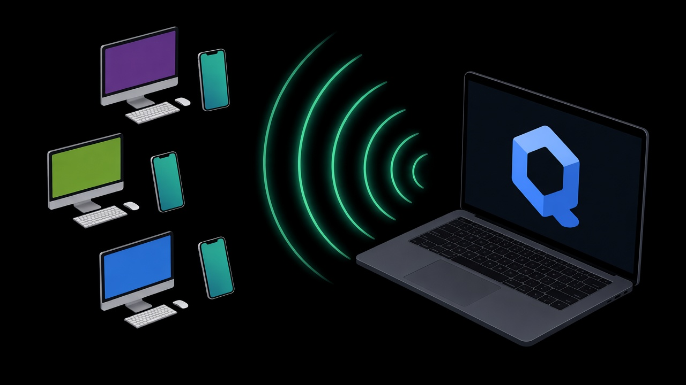

# tether

Share a Qubes OS qube's internet with devices on USB Ethernet and USB Wi-Fi.

tether turns a dedicated qube into a router. Plug USB Ethernet adapters or AP-capable USB Wi-Fi dongles into the qube, and the devices behind them (laptops, phones, anything) get internet through that qube's NetVM, which can be a VPN, Whonix or sys-firewall. sys-net stays untouched.

## Requirements

- Qubes OS with a Debian-based qube (Fedora support is planned for a later version)
- USB Ethernet adapters and/or USB Wi-Fi dongles that support AP mode (check with `iw list`, look for "AP" under "Supported interface modes")

## Where to install it

- **To try it:** install in an AppVM. It works until the next reboot, then it is gone.
- **For permanent use:** install in a dedicated TemplateVM and run it from an AppVM based on it. Every AppVM based on that template runs tether and takes your USB adapters, so don't use a shared template.
- A StandaloneVM works too.

## Install

```sh
chmod +x tether.sh
sudo ./tether.sh install
```

This installs the needed packages (dnsmasq-base, nftables, iproute2, usb-modeswitch, hostapd, iw, ethtool), copies itself to `/usr/bin/tether`, writes `/etc/tether.conf` if it's missing and starts the `tether-watch` service, which also runs at every boot.

## Commands

| Command | What it does |
|---|---|
| `tether install` | Install tether and start it. Must be run first. |
| `tether status` | Adapters and dongles, link state, connected devices, bridge, DNS/DHCP, uplink and the last log lines. As root it also shows firewall counters and Wi-Fi passwords. |
| `tether settings` | Open `/etc/tether.conf` in your editor. Changes apply after `tether reload`. |
| `tether log` | Open `/var/log/tether.log` read-only. |
| `tether reload` | Check the settings and apply them. On an error it prints the line number and reason and changes nothing. |
| `tether reset` | Reset all settings to default, keeping the old file as `/etc/tether.conf.bak`. |
| `tether uninstall` | Remove everything tether added, then offer to remove the packages it installed. |

Commands that change something need root and use sudo automatically.

## How it works

One background service, `tether-watch`, checks for adapters every few seconds and:

- joins plugged-in USB Ethernet adapters to one bridge (`br-tether`) and removes them when unplugged
- switches adapters that show up as a virtual CD-ROM into network mode
- turns each AP-capable Wi-Fi dongle into an access point on the same bridge, with a new random name and password written to `/etc/tether.conf` (set `STICKY=1` in the dongle's section to keep them; in an AppVM, set it in the template, since changes inside an AppVM are lost on reboot)
- runs DHCP and DNS for the devices and restarts it if it stops

Devices get addresses in `192.168.100.0/24` by default and are blocked from your other qubes and private networks (`BLOCK_PRIVATE=1`). Ports and Wi-Fi clients are isolated from each other by default. Every event is logged to `/var/log/tether.log`.

## Settings

All settings live in `/etc/tether.conf`, with a comment on each line. Highlights: `DHCP`, `LEASE_TIME`, `STATIC_LEASES`, `MAC_ALLOWLIST`, `DNS`, `DNS_BLOCKLIST`, `ALLOW_PING`, `BLOCK_PRIVATE`, `ISOLATE_USB_PORTS`, `ISOLATE_WIFI_CLIENTS` and `WIFI`. Each Wi-Fi dongle gets a `[device]` section (band, channel, country code, sticky, MAC randomizing) with a nested `[ap]` section (SSID, password, security, hidden).

## 5 GHz on Qubes

The Qubes kernel rejects the signature on Debian's Wi-Fi regulatory database, which blocks 5 GHz. `tether install` switches to the upstream database automatically. If a country can't be applied, tether falls back to 2.4 GHz.

## License

Public domain (the Unlicense)
